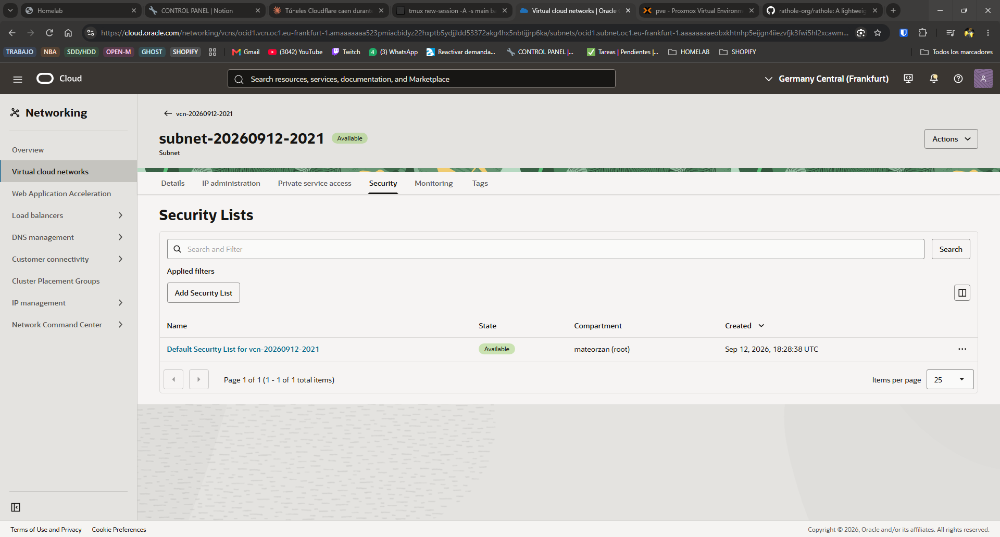
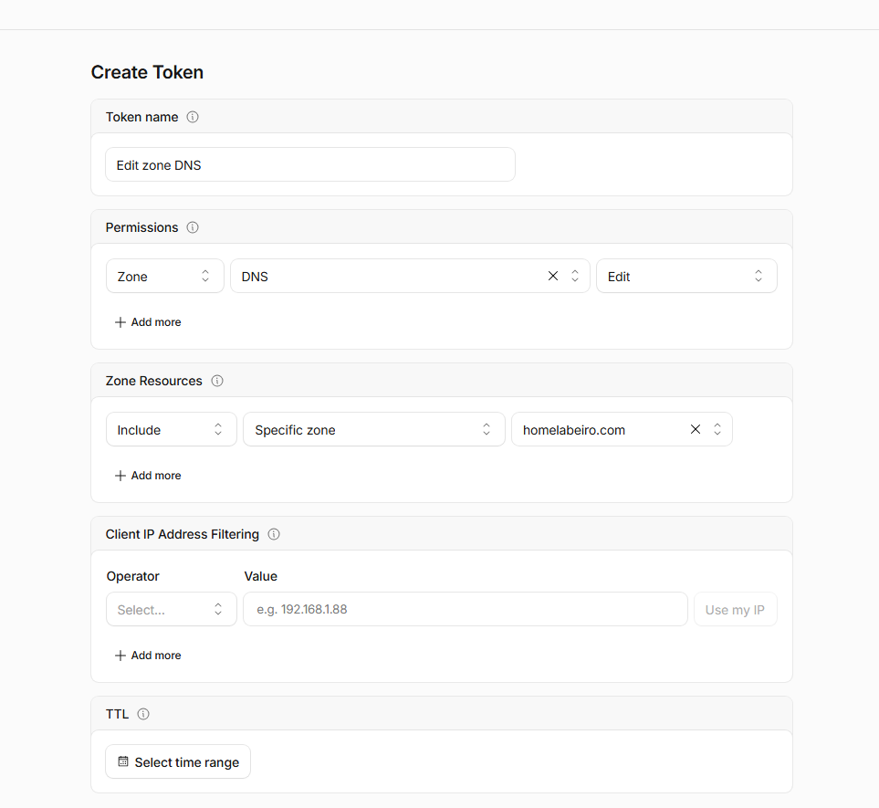
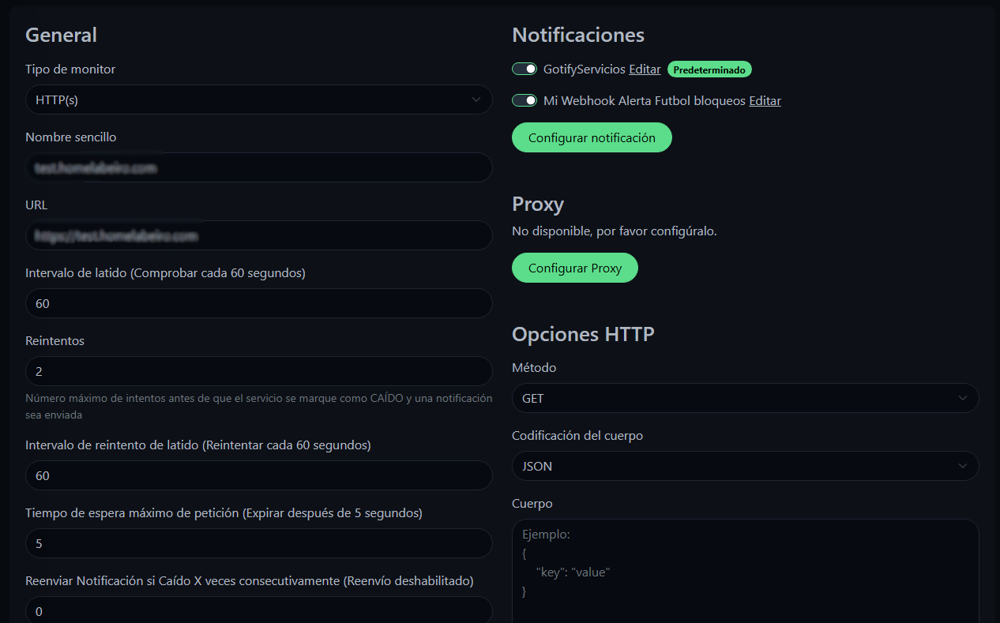
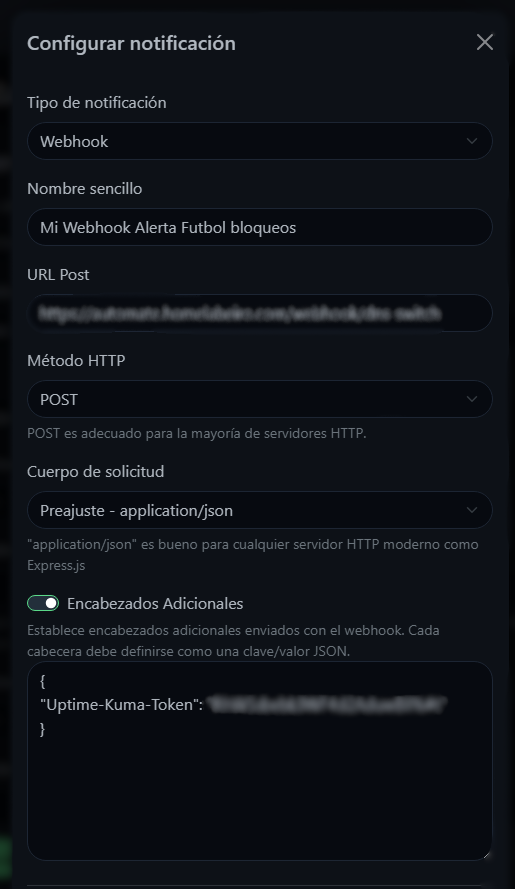
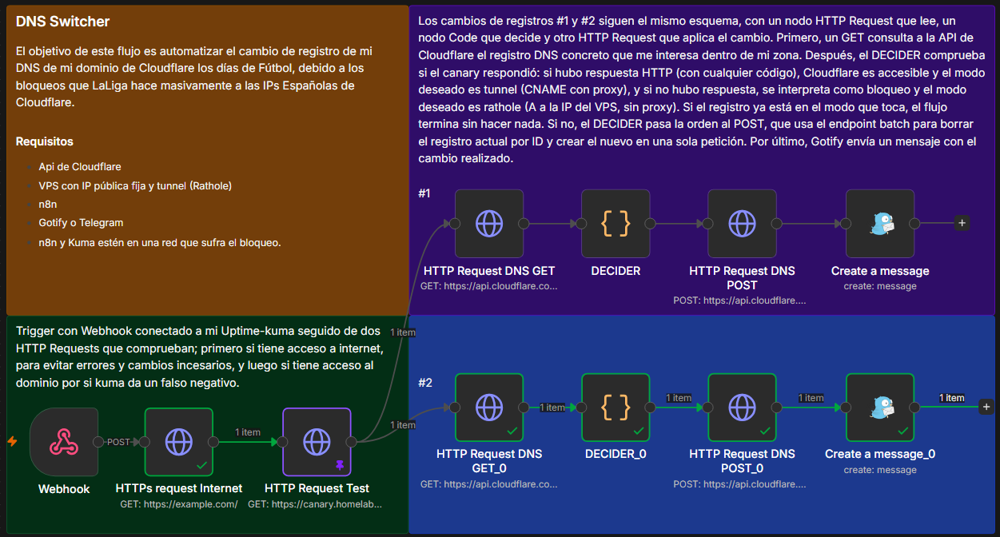
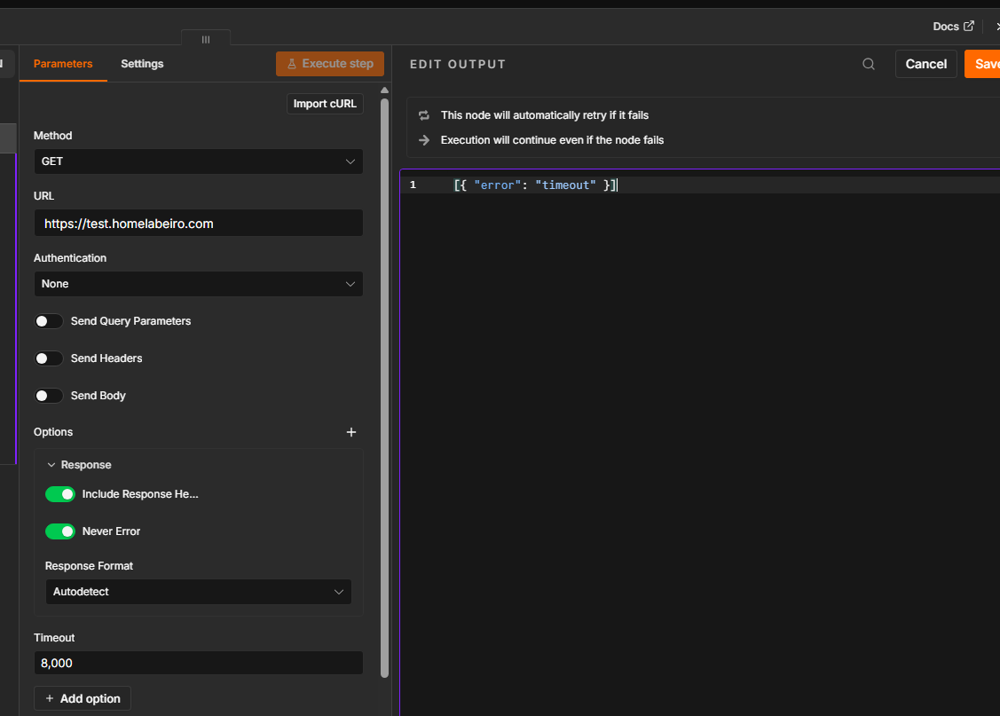

# Configuración Rathole

##### 11. Decisión de arquitectura: rathole sin Caddy

Se descartó montar Caddy como reverse proxy en el VPS — ya existe **Nginx Proxy Manager (NPM)** en el homelab gestionando TLS y el routing por dominio para todos los servicios. `rathole` en el VPS actúa como **tubería TCP pura** (reenvía el puerto 80/443 tal cual), sin terminar TLS ni decidir dominios — esa lógica la sigue llevando NPM en destino, igual que hace ahora con Cloudflare Tunnel.

```
Internet → dominio (DNS) → VPS: rathole servidor (solo reenvía)
                                    ↓ túnel saliente cifrado
                               Homelab: rathole cliente
                                    ↓
                               NPM (TLS + routing por dominio, sin cambios)
                                    ↓
                               Ghost / web NBA / fredricwatch.com
```

Convive sin conflicto con `cloudflared`, que sigue corriendo en la misma máquina del homelab — ambos son solo clientes salientes, ninguno escucha puertos, así que no hay colisión. Mientras el DNS apunte a Cloudflare, el tráfico real pasa por ahí; el túnel de rathole queda listo pero inactivo hasta que se cambie el DNS.

##### 12. Generación del token y elección del puerto de control

```bash
openssl rand -hex 32
```

Mismo token usado en servidor (VPS) y cliente (homelab) — es lo que autentica la conexión.

Se decidió **no usar el 2333 por defecto** (el de la documentación oficial de rathole, muy predecible/escaneado) y usar en su lugar el puerto **58422**, como medida extra de seguridad por oscuridad.

##### 13. Instalación de rathole en el VPS (servidor, arquitectura ARM)

```bash
cd ~
wget https://github.com/rapiz1/rathole/releases/latest/download/rathole-aarch64-unknown-linux-musl.zip
sudo apt install -y unzip
unzip rathole-aarch64-unknown-linux-musl.zip
sudo mv rathole /usr/local/bin/
rathole --version
```

##### 15. Configuración del servidor y servicio systemd

`/etc/rathole/server.toml`:

```toml
[server]
bind_addr = "0.0.0.0:58422"

[server.services.http]
token = "TOKEN_GENERADO"
bind_addr = "0.0.0.0:80"

[server.services.https]
token = "TOKEN_GENERADO"
bind_addr = "0.0.0.0:443"
```

`/etc/systemd/system/rathole-server.service`:

```ini
[Unit]
Description=Rathole Server
After=network.target

[Service]
ExecStart=/usr/local/bin/rathole --server /etc/rathole/server.toml
Restart=always
RestartSec=5
User=root


[Install]
WantedBy=multi-user.target
```

```bash
sudo systemctl daemon-reload
sudo systemctl enable rathole-server --now
sudo systemctl status rathole-server
```

##### 16. Firewall interno del VPS (ufw) — puerto de control

```bash
sudo ufw allow 58422/tcp
```

(80 y 443 ya estaban abiertos desde el endurecimiento inicial, paso 10)

##### 17. Security List de Oracle — apertura de los tres puertos

Oracle tiene **dos capas de firewall** independientes: `ufw` (dentro de la instancia) y el **Security List** de la VCN (a nivel de red). Sin abrir esta segunda capa, nada llega aunque `ufw` esté bien configurado.

En la consola: **Networking → Virtual Cloud Networks → [tu VCN]→  [tu subnet]→ Security Lists → Default Security List → Add Ingress Rules**



Tres reglas (Source Port Range vacío/All en las tres — ese campo es el puerto de origen del visitante, no el destino):

| Source CIDR | IP Protocol | Destination Port Range |
| ------------- | ----------- | ---------------------- |
| `0.0.0.0/0` | TCP | `80` |
| `0.0.0.0/0` | TCP | `443` |
| `0.0.0.0/0` | TCP | `58422` |

##### 17. Monitoreo y acceso remoto

Por último  instalamos Tailscale y Beszel-agent para poder acceder remotamente al servidor a traves de la VPN si lo necesitamos y tambien para poder monitorizar su estado a traves de nuestro panel de beszel.

```
ssh -i ~/.ssh/oracle-vps.key ubuntu@IP-VPS

# Tailscale

curl -fsSL https://tailscale.com/install.sh | sh && sudo tailscale up --auth-key=********

# Beszel-Agent

curl -sL https://get.beszel.dev -o /tmp/install-agent.sh && chmod +x /tmp/install-agent.sh && /tmp/install-agent.sh -p 45876 -k "*****" -t "*****" -url "http://ubuntu-keepass:PORT"
```

Cree Politicas dentro de Tailscale para restringir su acceso y que desde VPS no te puedas conectar a ningun equipo de mi red pero si se pueda comunicar con Tailscale.

##### 18. Endurecimiento del servidor Rathole para mayor seguridad

Vamos a aplicar mejoras una vez comprobamos que Rathole funciona con una configuración básica, esto se aplica tanto a nivel de servidor como de cliente.

Lo primero que vamos a aplicar es un protocolo que cifre nuestras conexiones asi evitamos que esa información pueda ser carpturada por otra persona, para esto tenemos dos opciones que son TLS(Transport Layer Security) es un metodo de cifrado que usa certificados para asegurarse que con el servidor que se comunica esta autorizado o noise que es otro protocolo de cifrado pero este funciona con claves publicas, parecido a como funciona SSH. En mi caso voy a usar noise ya que es mucho mas sencillo de mantener y de gestionar y nos da esa comodidad.

Lo primero de todo es general las claves de noise para esto es tan facil como ejecutar.

`rathole --genkey` # Compiamos y guardamos tanto la publica como la privada.

Luego tenemos que configurar los dos archivos de config tanto el `server.toml` y el `client.toml`

```Shell
# Añadimos estas dos lineas a la configuración base.

# server.toml

[server.transport]
type = "noise"

[server.transport.noise]
local_private_key = "CLAVE_PRIVADA_BASE64"

# client.toml

[client.transport]
type = "noise"

[client.transport.noise]
remote_public_key = "CLAVE_PUBLICA_BASE64"
```

Ahora hacemos la prueba de que todo funciona ademas de mirar los logs y que ninguno nos de error.

```Shell
systemctl status rathole-server.service 
docker logs rathole-client

# Comprobaciones de encriptación y conectividad
sudo tcpdump -i any -A -nn port 58422 -c 50 # Capturamos el trafico del puerto del tunel y vemos 
                                            # que esta todo cifrado y no es legible.

curl -i http://test.midominio.com           # Con un dominio de prueba que el dns apunte a nuestro VPS 
                                            # importante, hacemos un curl, con esto comprobamos que el 
                                            # tunnel funciona
```

##### 19. Automatización del registro DNS

Para esto vamos a usar un flujo de n8n que se conecta a la API de Cloudflare y hace el cambio de registro solo cuando las IPs de Cloudflare son bloqueadas, es decir, los días de fútbol.

La idea y la lógica que vamos a seguir es usar un registro de dominio que siempre va a estar apuntando a Cloudflare y con su proxy. Este va a ser el dominio de control (canary) que nos indica si Cloudflare está siendo bloqueado o no. Según el estado de este dominio, es decir, si está caído, se activa el flujo y cambia el resto de registros DNS a mi VPS, quitando el proxy ("nube gris"). Cuando el dominio de control recupera la conexión, el flujo se vuelve a activar y devuelve los registros a CNAME con el proxy activado ("nube naranja").

Para automatizar todo este proceso vamos a usar Uptime Kuma y n8n. Uptime Kuma es el que está siempre atento al dominio de control y avisa a n8n cuando cambia de estado. n8n se encarga de decidir si hay que tocar el DNS o no, según las condiciones que le demos.

###### Requisitos

- Dominio propio en Cloudflare
- API token de Cloudflare
- n8n
- Uptime Kuma
- Gotify o Telegram (para las notificaciones)
- Servidor VPS con Rathole bien configurado
- Uptime Kuma y n8n tienen que estar en una red que sufra el bloqueo (por ejemplo, una conexión doméstica en España). Si estuvieran en un datacenter, el dominio de control siempre respondería y nunca se detectaría nada.

Lo primero es crear el token en Cloudflare con acceso a editar las zonas DNS del dominio que quieras.

My Profile -> API Tokens -> Create Token

Aquí dentro vamos a usar la plantilla que ya existe, "Edit zone DNS", y simplemente hay que especificar el dominio al que quieres dar permiso.



Este token se guarda como credencial de Cloudflare en n8n. También necesitamos el Zone ID del dominio, que está en la página de resumen de la zona.

###### Dominio de control (canary)

Creamos un registro individual (por ejemplo `canary.homelabeiro.com`) que siempre esté con el proxy activado (nube naranja) y que el flujo nunca modifique. No debe quedar cubierto por un registro wildcard: si solo lo cubre el wildcard, cambiaría de modo junto con el resto, pasaría a apuntar al VPS, que sí responde, y dejaría de medir Cloudflare.

###### Monitor en Uptime Kuma

Creamos un monitor HTTP(s) que apunte al dominio de control, con estos ajustes:

- Intervalo de 60 s, timeout de unos 5 o 10 s y 2 o 3 reintentos, para no reaccionar a un fallo puntual.
- Dejamos los Accepted Status Codes por defecto: Kuma marcará el monitor como caído tanto por un fallo de conexión como por un error HTTP (por ejemplo, un 530). No es un problema, porque Kuma solo sirve de disparador. Quien decide si hay que cambiar el DNS es n8n, y solo lo hace cuando el canary no responde en absoluto.



Después creamos una notificación de tipo Webhook que apunte a la Production URL del webhook de n8n, con Content Type `application/json` y una cabecera de autenticación en Additional Headers:

```json
{
  "X-Token": "valor-aleatorio-largo"
}
```

Este mismo valor se configura en n8n como credencial Header Auth del nodo Webhook. La notificación la asociamos solo al monitor del dominio de control.



###### Flujo de n8n

Ahora ya podemos pasar al flujo de n8n, que debería verse de la siguiente forma. Esta versión solo contempla el cambio de un registro DNS.



El funcionamiento es el siguiente. Cuando Uptime Kuma detecta un cambio de estado en el canary (test.homelabeiro.com, siempre tras el proxy de Cloudflare), envía un aviso por webhook que arranca este flujo. Primero, HTTPs request Internet comprueba que n8n tiene conexión a internet usando example.com como control; si falla, el flujo se detiene para no tocar el DNS por una caída de nuestra propia red.

Después, HTTP Request Test consulta el canary con un timeout de 8 s y reintentos. Si responde con cualquier código HTTP (incluso un 403 o un 530), Cloudflare es alcanzable, y si no responde, se interpreta como bloqueo. Para que esto funcione, el nodo tiene que tener Never Error activado y, en sus ajustes, On Error en Continue, de modo que un timeout no pare el flujo.

A continuación, HTTP Request DNS GET lee desde la API de Cloudflare el registro actual del wildcard, y DECIDER compara el modo deseado (rathole si hay bloqueo, tunnel si no) con el modo actual del registro (A significa rathole, CNAME significa tunnel). Si ya coinciden, termina sin hacer nada.

Si no coinciden, prepara una petición batch que borra el registro y crea el nuevo, ya sea un A a la IP del VPS sin proxy o un CNAME al tunnel con proxy. Se usa batch porque Cloudflare ha dejado de dar soporte a cambiar el tipo de un registro existente (de CNAME a A) con PUT o PATCH. HTTP Request DNS POST envía esa petición a Cloudflare y, por último, Create a message avisa por Gotify del cambio realizado.

###### Testeos

Para comprobar que va a funcionar cuando Cloudflare sea bloqueado, hay que simular un error de timeout. Para ello fijamos (pin) la data `[{ "error": "timeout" }]` en HTTP Request Test y ejecutamos. Debería cambiar el registro DNS al VPS. Para probar que luego, cuando recupere la conexión, también hace el cambio de vuelta, hacemos lo mismo pero usando `[{ "statusCode": 200 }]`.

Hay que tener en cuenta algunas cosas:

- Para ver el cambio a A, el registro tiene que estar antes en CNAME. Si ya está en A, el flujo termina sin hacer nada, y parece que falla cuando en realidad es el comportamiento esperado.
- Los pines solo se aplican en ejecuciones manuales. Aun así, hay que quitarlos al terminar para no confundirse al depurar.
- Esta prueba solo valida la lógica de n8n y no pasa por Uptime Kuma. Para probar la cadena completa, cambiamos a la vez la URL del monitor de Kuma y la del nodo HTTP Request Test a una dirección que no responda (por ejemplo `https://10.255.255.1`). Cambiar solo la de Kuma no basta, porque n8n vuelve a comprobar el canary por su cuenta.



###### Cómo funciona el código del DECIDER

El DECIDER es un nodo Code con JavaScript y es el que decide si hay que cambiar el registro o no. Este es el código:

```javascript
// 1) ¿Bloqueado? Si hubo respuesta HTTP (aunque sea 403/404/530) NO está bloqueado.
//    Solo un fallo de conexión o timeout deja el item sin statusCode.
const test = $('HTTP Request Test').first().json;
const blocked = typeof test.statusCode !== 'number';
const desired = blocked ? 'rathole' : 'tunnel';

// 2) Registro leído desde Cloudflare (ignora otros tipos que compartan nombre)
const recs = $input.first().json.result || [];
const rec = recs.find(r => r.type === 'A' || r.type === 'CNAME');
if (!rec) throw new Error('No existe el registro A/CNAME');

// 3) Si ya está como toca, el flujo termina aquí
const current = rec.type === 'A' ? 'rathole' : 'tunnel';
if (current === desired) return [];

// 4) Registro nuevo según el modo deseado
const nuevo = desired === 'rathole'
  ? { type: 'A', name: rec.name, content: 'IP_DE_TU_VPS', proxied: false, ttl: 60 }
  : { type: 'CNAME', name: rec.name, content: 'UUID-DEL-TUNNEL.cfargotunnel.com', proxied: true, ttl: 1 };

// 5) Petición batch: borrar el actual por ID y crear el nuevo
return [{ json: { body: { deletes: [{ id: rec.id }], posts: [nuevo] }, desired } }];
```

**1. Detectar el bloqueo.** El código lee la salida del nodo `HTTP Request Test` y comprueba si trae un `statusCode` numérico. Si hubo respuesta HTTP, aunque sea un 403 o un 530, el canary tiene `statusCode` y no hay bloqueo, así que el modo deseado es `tunnel`. Si el nodo agotó los reintentos sin conectar, el item sale sin `statusCode`, se interpreta como bloqueo y el modo deseado es `rathole`. Es el mismo caso que simulamos con el pin `[{ "error": "timeout" }]`.

**2. Leer el registro actual.** El DECIDER recibe la respuesta del GET a Cloudflare. De la lista de resultados se queda con el primer registro de tipo `A` o `CNAME`, así que ignora otros tipos que compartan nombre. Si no encuentra ninguno, lanza un error y el flujo se detiene en ese nodo, y el fallo queda visible en el historial de ejecuciones.

**3. Comparar y decidir.** El estado actual se deduce del tipo de registro: `A` es rathole y `CNAME` es tunnel. Si coincide con el modo deseado, el nodo devuelve una lista vacía, lo que hace que el resto de la rama no se ejecute: no hay POST ni aviso de Gotify. Por eso un aviso repetido de Kuma no hace nada.

**4. Preparar el registro nuevo.** Según el modo deseado, se construye el registro que sustituirá al actual:

|           | rathole                 | tunnel                               |
| --------- | ----------------------- | ------------------------------------ |
| Tipo      | `A`                   | `CNAME`                            |
| Contenido | IP del VPS              | `UUID-DEL-TUNNEL.cfargotunnel.com` |
| Proxy     | No (`proxied: false`) | Sí (`proxied: true`)              |
| TTL       | 60 s                    | Automático (`ttl: 1`)             |

**5. Devolver la petición.** El nodo devuelve un objeto con dos listas para el endpoint batch: `deletes`, con el ID del registro actual, y `posts`, con el registro nuevo. El nodo POST lo convierte en texto con `JSON.stringify($json.body)` y lo envía a Cloudflare.

Resumen de lo que hace el código en cada caso:

| Canary      | Registro actual | Resultado                    |
| ----------- | --------------- | ---------------------------- |
| Responde    | `CNAME`       | No hace nada                 |
| Responde    | `A`           | Cambia a `CNAME` con proxy |
| No responde | `CNAME`       | Cambia a `A` sin proxy     |
| No responde | `A`           | No hace nada                 |

Cosas que hay que tener en cuenta:

- El código busca el nodo del canary por su **nombre** (`$('HTTP Request Test')`). Si renombras ese nodo, hay que actualizar también esa línea, o el flujo dará error.
- El ID del registro **cambia** en cada cambio de modo, porque se borra y se crea uno nuevo. No hay que guardar IDs, ya que el GET lo vuelve a leer en cada ejecución.
- La IP del VPS y el UUID del tunnel están escritos directamente en el código. Si hay más de una rama, **están repetidos en cada DECIDER**, y si cambian hay que actualizarlos en todos.
- Para depurar, se puede poner temporalmente antes de la comparación `return [{ json: { blocked, desired, current, recType: rec.type, testOutput: test } }];`, que muestra qué está decidiendo el código. Hay que quitarlo al terminar.

###### Conclusión

Con este flujo ya no tengo que cambiar los registros DNS a mano los días de fútbol. Uptime Kuma vigila el dominio de control y avisa a n8n cuando cambia de estado, y n8n decide si hay que mover los registros al VPS (sin proxy) o devolverlos al tunnel de Cloudflare (con proxy). Cuando no hay nada que cambiar, el flujo termina sin tocar nada y no recibo ningún aviso.

Lo más importante que he aprendido montándolo:

- **Un bloqueo no devuelve ningún código HTTP.** Un 403 o un 530 significan que Cloudflare sí respondió. Solo la ausencia total de respuesta (un timeout o un fallo de conexión) indica que está bloqueado, y ese es el único caso en el que el flujo cambia el DNS.
- **El dominio de control tiene que ser independiente.** Un registro propio, siempre con proxy y fuera del wildcard. Si no, el flujo entra en bucle.
- **Kuma avisa y n8n decide.** Kuma me enseña cualquier fallo del canary, incluidos los errores HTTP, pero el DNS solo cambia cuando n8n comprueba que no hay respuesta.
- **Cloudflare ya no admite cambiar el tipo de un registro con PUT o PATCH**, así que el flujo borra y crea el registro en una sola petición con el endpoint batch.

Limitaciones que conviene tener presentes:

- Kuma y n8n tienen que estar en una red que sufra el bloqueo. Si la API de Cloudflare también queda bloqueada, el flujo detecta el problema pero no puede aplicar el cambio.
- Cada rama hace su propio cambio, así que no son atómicas entre sí. Si una falla y la otra no, un registro puede quedar en un modo y el otro en el contrario.
- Si el bloqueo es intermitente, los registros podrían cambiar varias veces seguidas.

- Mientras dure el modo rathole, los dominios dejan de pasar por el proxy de Cloudflare y pierden su protección (WAF y mitigación de DDoS). La IP del VPS queda visible en el DNS, aunque la de mi casa sigue oculta detrás del túnel.

Por ahora lo he probado simulando el bloqueo, tanto la ida (cambio al VPS) como la vuelta (cambio a Cloudflare). Queda pendiente verlo en un partido real. Cuando ocurra, revisaré el historial de ejecuciones de n8n y el mensaje que muestra Kuma para confirmar que el bloqueo se comporta como esperaba, y actualizaré esta documentación con lo que observe.

Como siguientes pasos, se podría ampliar el flujo para procesar una lista de registros en un solo batch, y añadir una espera antes de volver al tunnel para evitar cambios repetidos en bloqueos intermitentes.
