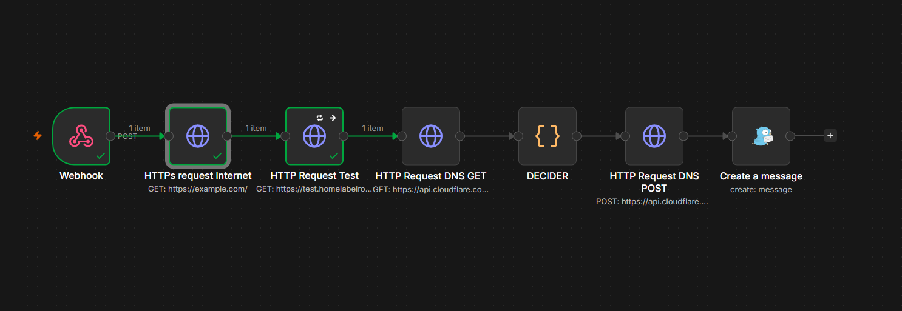

# Configuración Rathole

##### 11. Decisión de arquitectura: rathole sin Caddy

Se descartó montar Caddy como reverse proxy en el VPS — ya existe **Nginx Proxy Manager (NPM)** en el homelab gestionando TLS y el routing por dominio para todos los servicios. `rathole` en el VPS actúa como **tubería TCP pura** (reenvía el puerto 80/443 tal cual), sin terminar TLS ni decidir dominios — esa lógica la sigue llevando NPM en destino, igual que hace ahora con Cloudflare Tunnel.

```
Internet → dominio (DNS) → VPS: rathole servidor (solo reenvía)
                                    ↓ túnel saliente cifrado
                               Homelab: rathole cliente
                                    ↓
                               NPM (TLS + routing por dominio, sin cambios)
                                    ↓
                               Ghost / web NBA / fredricwatch.com
```

Convive sin conflicto con `cloudflared`, que sigue corriendo en la misma máquina del homelab — ambos son solo clientes salientes, ninguno escucha puertos, así que no hay colisión. Mientras el DNS apunte a Cloudflare, el tráfico real pasa por ahí; el túnel de rathole queda listo pero inactivo hasta que se cambie el DNS.

##### 12. Generación del token y elección del puerto de control

```bash
openssl rand -hex 32
```

Mismo token usado en servidor (VPS) y cliente (homelab) — es lo que autentica la conexión.

Se decidió **no usar el 2333 por defecto** (el de la documentación oficial de rathole, muy predecible/escaneado) y usar en su lugar el puerto **58422**, como medida extra de seguridad por oscuridad.

##### 13. Instalación de rathole en el VPS (servidor, arquitectura ARM)

```bash
cd ~
wget https://github.com/rapiz1/rathole/releases/latest/download/rathole-aarch64-unknown-linux-musl.zip
sudo apt install -y unzip
unzip rathole-aarch64-unknown-linux-musl.zip
sudo mv rathole /usr/local/bin/
rathole --version
```

##### 15. Configuración del servidor y servicio systemd

`/etc/rathole/server.toml`:

```toml
[server]
bind_addr = "0.0.0.0:58422"

[server.services.http]
token = "TOKEN_GENERADO"
bind_addr = "0.0.0.0:80"

[server.services.https]
token = "TOKEN_GENERADO"
bind_addr = "0.0.0.0:443"
```

`/etc/systemd/system/rathole-server.service`:

```ini
[Unit]
Description=Rathole Server
After=network.target

[Service]
ExecStart=/usr/local/bin/rathole --server /etc/rathole/server.toml
Restart=always
RestartSec=5
User=root


[Install]
WantedBy=multi-user.target
```

```bash
sudo systemctl daemon-reload
sudo systemctl enable rathole-server --now
sudo systemctl status rathole-server
```

##### 16. Firewall interno del VPS (ufw) — puerto de control

```bash
sudo ufw allow 58422/tcp
```

(80 y 443 ya estaban abiertos desde el endurecimiento inicial, paso 10)

##### 17. Security List de Oracle — apertura de los tres puertos

Oracle tiene **dos capas de firewall** independientes: `ufw` (dentro de la instancia) y el **Security List** de la VCN (a nivel de red). Sin abrir esta segunda capa, nada llega aunque `ufw` esté bien configurado.

En la consola: **Networking → Virtual Cloud Networks → [tu VCN]→  [tu subnet]→ Security Lists → Default Security List → Add Ingress Rules**


Tres reglas (Source Port Range vacío/All en las tres — ese campo es el puerto de origen del visitante, no el destino):

| Source CIDR | IP Protocol | Destination Port Range |
| ------------- | ----------- | ---------------------- |
| `0.0.0.0/0` | TCP | `80` |
| `0.0.0.0/0` | TCP | `443` |
| `0.0.0.0/0` | TCP | `58422` |

##### 17. Monitoreo y acceso remoto

Por último  instalamos Tailscale y Beszel-agent para poder acceder remotamente al servidor a traves de la VPN si lo necesitamos y tambien para poder monitorizar su estado a traves de nuestro panel de beszel.

```
ssh -i ~/.ssh/oracle-vps.key ubuntu@IP-VPS

# Tailscale

curl -fsSL https://tailscale.com/install.sh | sh && sudo tailscale up --auth-key=********

# Beszel-Agent

curl -sL https://get.beszel.dev -o /tmp/install-agent.sh && chmod +x /tmp/install-agent.sh && /tmp/install-agent.sh -p 45876 -k "*****" -t "*****" -url "http://ubuntu-keepass:PORT"
```

Cree Politicas dentro de Tailscale para restringir su acceso y que desde VPS no te puedas conectar a ningun equipo de mi red pero si se pueda comunicar con Tailscale.

##### 18. Endurecimiento del servidor Rathole para mayor seguridad

Vamos a aplicar mejoras una vez comprobamos que Rathole funciona con una configuración básica, esto se aplica tanto a nivel de servidor como de cliente.

Lo primero que vamos a aplicar es un protocolo que cifre nuestras conexiones asi evitamos que esa información pueda ser carpturada por otra persona, para esto tenemos dos opciones que son TLS(Transport Layer Security) es un metodo de cifrado que usa certificados para asegurarse que con el servidor que se comunica esta autorizado o noise que es otro protocolo de cifrado pero este funciona con claves publicas, parecido a como funciona SSH. En mi caso voy a usar noise ya que es mucho mas sencillo de mantener y de gestionar y nos da esa comodidad.

Lo primero de todo es general las claves de noise para esto es tan facil como ejecutar.

`rathole --genkey` # Compiamos y guardamos tanto la publica como la privada.

Luego tenemos que configurar los dos archivos de config tanto el `server.toml` y el `client.toml`

```Shell
# Añadimos estas dos lineas a la configuración base.

# server.toml

[server.transport]
type = "noise"

[server.transport.noise]
local_private_key = "CLAVE_PRIVADA_BASE64"

# client.toml

[client.transport]
type = "noise"

[client.transport.noise]
remote_public_key = "CLAVE_PUBLICA_BASE64"
```

Ahora hacemos la prueba de que todo funciona ademas de mirar los logs y que ninguno nos de error.

```Shell
systemctl status rathole-server.service 
docker logs rathole-client

# Comprobaciones de encriptación y conectividad
sudo tcpdump -i any -A -nn port 58422 -c 50 # Capturamos el trafico del puerto del tunel y vemos 
                                            # que esta todo cifrado y no es legible.

curl -i http://test.midominio.com           # Con un dominio de prueba que el dns apunte a nuestro VPS 
                                            # importante, hacemos un curl, con esto comprobamos que el 
                                            # tunnel funciona
```

##### 19. Script y automatizacion resgistro DNS

Para esto vamos a usar un script que se conecte a la api de Cloudflare y haga el cambio de registro solo cuando la IP de Cloudflare sea bloqueada, es decir, los dias de Fútbol.

La idea y la logica que vamos a seguir es usando un resgistro de dominio que siempre va a estar apuntando a cloudflare y con su proxy, este va a ser el dominio de control que nos va a indicar si cloduflare esta siendo bloqueado o no. Según el estado de este dominio , es decir, si esta caido activara el script y cambiará el resto de registros de dominios DNS a mi VPS y quitara el proxy "nube gris" y una vez recupere la conexion el dominio. el script se volvera a activar y cambiara otra vez el registro de dominios DNS a CNAME y Proxy activado "nube naranja". Para automatizar todo este proceso vamos a usar N8N el se encargara de estar siempre atento y decidir cuando activar el flujo y cuando no, segun las condiciones que le demos.

###### Requisitos

- Dominio propio de Cloudflare
- Api token en Cloudflare
- n8n
- Servidor VPS con rathole bien configurado

Lo primero es crear el token en cloudflare con acceso a editar las zonas DNS de el dominio que tu quieras.

My Profile -> Api Tokens -> Create Token

Aqui dentro vamos a usar la plantila que ya existe "Edit zone DNS" y simplemente hay que especificar el dominio que quieres dar permiso.


Ahora ya podemos pasar al flujo de n8n, que se deberia de ver de la siguiente forma, esta version solo contempla el cambio de un registro DNS.



El funcionamiento es el siguiente, cuando Uptime Kuma detecta un cambio de estado en el canary (test.homelabeiro.com, siempre tras el proxy de Cloudflare), envía un aviso por webhook que arranca este flujo. Primero, HTTPs request Internet comprueba que n8n tiene conexión a internet usando example.com como control; si falla, el flujo se detiene para no tocar el DNS por una caída de red propia. Después, HTTP Request Test consulta el canary con timeout de 8 s y reintentos: si responde con cualquier código HTTP, Cloudflare es alcanzable, y si no responde, se interpreta como bloqueo. A continuación, HTTP Request DNS GET lee desde la API de Cloudflare el registro actual del wildcard *.homelabeiro.com, y DECIDER compara el modo deseado (rathole si hay bloqueo, tunnel si no) con el modo actual del registro (A significa rathole, CNAME significa tunnel). Si ya coinciden, termina sin hacer nada. Si no, prepara una petición batch que borra el registro y crea el nuevo, ya sea un A a la IP del VPS sin proxy o un CNAME al tunnel con proxy. HTTP Request DNS POST envía esa petición a Cloudflare y, por último, Create a message te avisa por Gotify del cambio realizado.

Testeos, para comprobar que vaya a funcionar cuando cloudflare sea bloqueado hay que simular un error de timeout para ello fijamos la data `[{ "error": "timeout" }]` en HTTP Resques Test y ejecutamos, deberia de cambiar el registro DNS a el VPS, para probar que luego cuando recupere conexión tambien hace el cambio hacemos lo mismo pero usamos el codigo `[{ "statusCode": 200 }]`.


