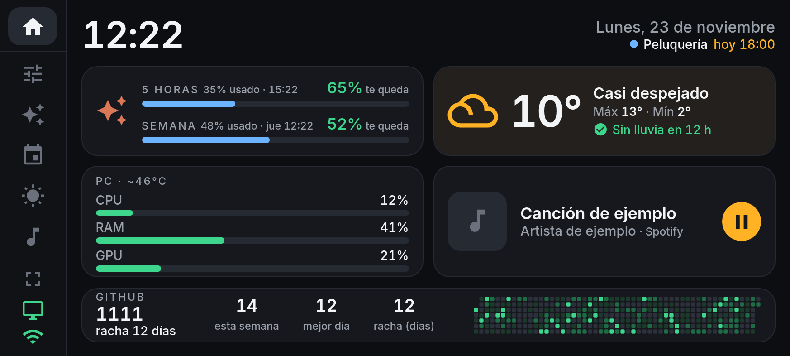
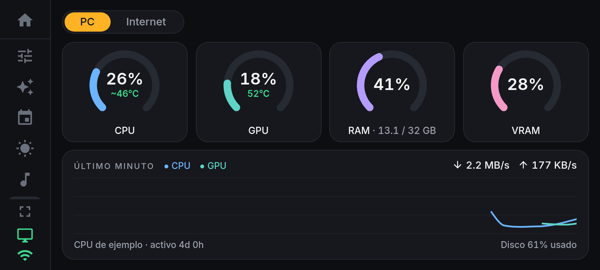
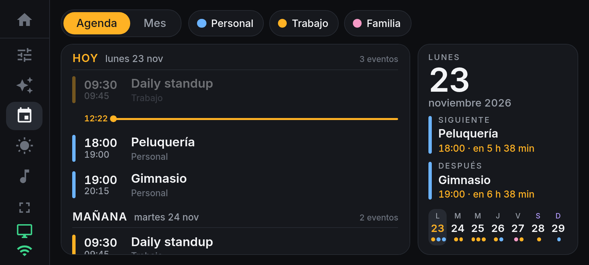
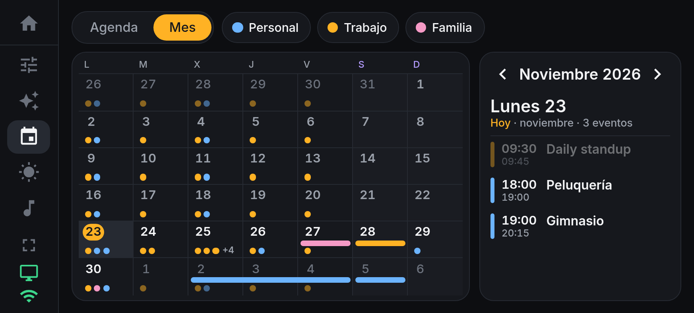
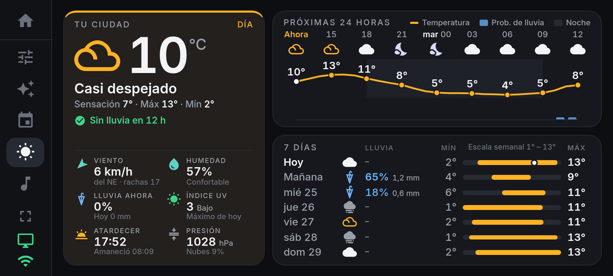
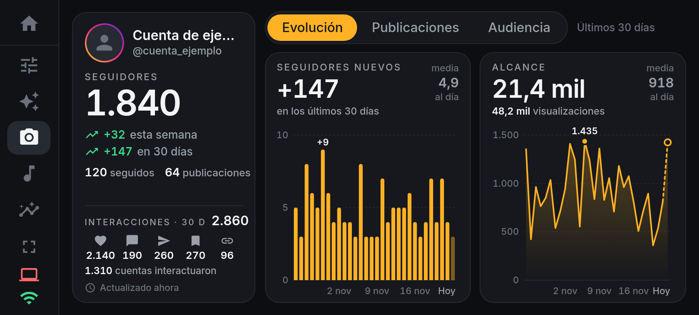
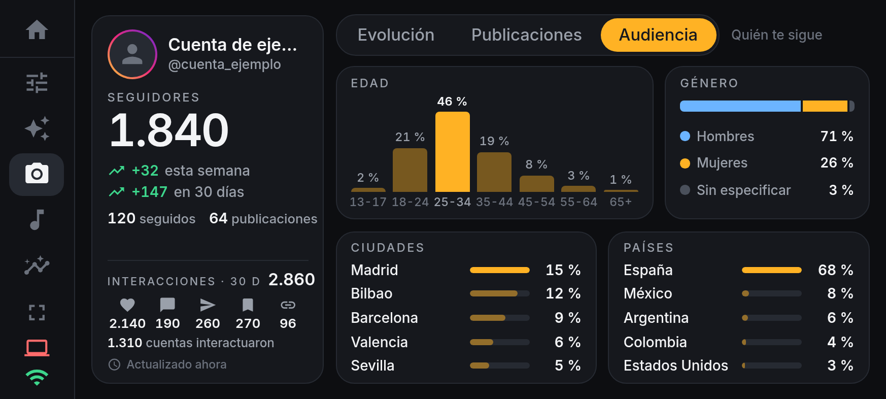

## Dock Dashboard

Tenía un móvil viejo parado y lo usaba como tercera pantalla con MacroDeck, solo con botones. Quería llevarlo a otro nivel: un dock que además de controlar mi PC me enseñe información útil (métricas de los equipos, clima, calendario, uso de Claude Code, música, la impresora 3D...). Me inspiré en [deskhub](https://github.com/zacharyinserra/deskhub), un dock para una pantalla ESP32, pero en vez de firmware lo hice como **web app**: el móvil solo abre una página, así que sirve cualquier pantalla.

El código está en mi repositorio privado `Dock_dashboard` y es Node.js **sin dependencias** (no hay `npm install`). La Raspberry es el sitio ideal para el servidor porque está encendida 24/7 y ya corre el resto de mis dashboards.

### Cómo funciona

Mi equipo principal es un PC de sobremesa con Windows 11, no esta Raspberry, así que el servicio se reparte en tres piezas:

```text
Móvil (Chrome / app instalada) ── HTTPS por Tailscale ──▶ HUB en la Raspberry (Docker)
                                                          │   sondea cada 1 s (10 s si nadie mira)
                                                          ├──▶ AGENTE en el PC (Windows 11)  principal
                                                          ├──▶ AGENTE en el portátil (Linux)
                                                          └──▶ Impresora Bambu Lab (red local, solo lectura)
```

* **Hub**: es lo único a lo que se conecta el móvil. Sirve la web, junta los datos de los agentes y aporta lo que no depende de un PC: clima, calendario, domótica e internet.
* **Agente**: un programa pequeño que corre en cada ordenador, con un adaptador por sistema operativo. Lee métricas, música, volumen y atajos de *esa* máquina. El del PC es el **principal** (música, volumen, mezclador, atajos, GPU) y el del portátil aporta su pestaña de estadísticas y el uso de Claude Code.
* **Móvil**: solo es la pantalla, nunca ejecuta comandos. Manda el nombre de un atajo y es el agente quien ejecuta el comando que tiene en su propia configuración.

### Así se ve

Capturas con datos de ejemplo. La pantalla de inicio junta lo más importante, con el próximo evento del calendario bajo la fecha, y cada widget abre su pestaña al tocarlo.



Estadísticas de cada equipo, con una pestaña por dispositivo y la temperatura dentro de cada medidor.



El calendario junta varias cuentas de Google con un color para cada una, en vista de agenda y de mes. Las chips de arriba ocultan o muestran cada cuenta.





Y el tiempo, con las próximas 24 horas y los 7 días siguientes.



Las estadísticas de una cuenta de Instagram: seguidores nuevos y alcance de los últimos 30 días, y la audiencia por edad, género, ciudades y países. Hay una tercera pestaña con las últimas publicaciones.





### Requisitos

- Docker y Docker Compose en la Raspberry (explicado en [Servicios](./2-Servicios.md)).
- Tailscale en la Raspberry, el PC, el portátil y el móvil.
- Node.js 22 o superior en los equipos que llevan agente.
- Un runner de GitHub Actions en la Raspberry para el despliegue automático.

### Docker Compose

Solo hacen falta dos archivos en la Raspberry, el compose y la configuración del hub.

```Shell
services:
  dock-hub:
    image: ghcr.io/mateorzan/dock-hub:latest
    container_name: dock-hub
    restart: unless-stopped
    network_mode: host
    volumes:
      - ./hub/config.json:/config/config.json
```

```bash
mkdir -p ~/Dock-Hub/hub
cd ~/Dock-Hub
docker compose pull
docker compose up -d
docker inspect --format='{{.State.Health.Status}}' dock-hub
```

* **network_mode: host**: aquí no publico el puerto con `ports:`, porque Docker **se salta UFW** (explicado en [Seguridad](./6-Seguridad.md)). Con la red del host, el puerto 8787 lo gobierna UFW como el resto de servicios. Además el hub llega directamente a los agentes por Tailscale, sin NAT por medio.
* **volumes**: la configuración se monta como archivo y el hub la recarga solo al guardar, sin reiniciar.

> IMPORTANTE: Como el hub corre con la red del host, `127.0.0.1` es la propia Raspberry. Las direcciones de los agentes en la configuración tienen que ser IPs que se alcancen desde ella (Tailscale o LAN).

### Configuración del hub

`nano ~/Dock-Hub/hub/config.json`

```Shell
{
  "port": 8787,
  "token": "CONTRASEÑA_DEL_MOVIL",
  "trustTailnet": true,
  "saverMinutes": 30,
  "timezone": "Europe/Madrid",
  "primary": "pc",
  "agents": [
    { "id": "pc", "name": "PC", "url": "http://IP_TAILSCALE_PC:8788", "token": "TOKEN_DEL_PC" },
    { "id": "laptop", "name": "Portátil", "url": "http://IP_TAILSCALE_PORTATIL:8788", "token": "TOKEN_DEL_PORTATIL" }
  ],
  "aiFrom": ["laptop"],
  "githubFrom": "laptop",
  "weather": { "lat": 40.41, "lon": -3.70, "city": "Tu ciudad" },
  "calendars": [
    { "name": "Personal", "color": "#6cb4ff", "url": "https://calendar.google.com/calendar/ical/.../basic.ics" }
  ],
  "printers": [
    { "id": "a1mini", "name": "A1 mini", "host": "IP_IMPRESORA", "serial": "NUMERO_DE_SERIE", "accessCode": "CODIGO_DE_ACCESO" }
  ]
}
```

```bash
chmod 600 ~/Dock-Hub/hub/config.json
```

* **token**: contraseña del móvil. Solo se pide si entras por la wifi/LAN; por Tailscale no, porque tu red ya identifica los dispositivos (`trustTailnet`).
* **primary**: el equipo que controla la música, el volumen, el mezclador, los atajos y OBS.
* **agents[].token**: uno distinto por agente. Si el agente tiene token, rechaza cualquier petición sin él.
* **aiFrom / githubFrom**: de qué agente sale el uso de Claude Code y las contribuciones de GitHub (el que tenga `gh` con la sesión iniciada).
* **calendars**: una entrada por cuenta o calendario, con su color.

> IMPORTANTE: Este archivo lleva todos los secretos (tokens, dirección secreta de los calendarios, código de la impresora) y **es la única copia**. No está en git, así que hay que incluirlo en la copia de seguridad.

### UFW

En [Seguridad](./6-Seguridad.md) ya tengo permitido todo lo que entra por `tailscale0`, así que el hub funciona por Tailscale sin tocar nada. Si además quiero abrirlo desde mi wifi sin Tailscale, solo para la LAN.

```bash
sudo ufw allow from 192.168.1.0/24 to any port 8787 proto tcp
```

> Por la LAN el tráfico va en HTTP sin cifrar, por eso la contraseña del móvil: protege del curioso pero no de quien esté escuchando la wifi. Para eso está Tailscale.

### HTTPS con Tailscale

Para instalar la página como app en el móvil (sin barra de URL y con la pantalla siempre encendida) el navegador exige HTTPS. Lo resuelve `tailscale serve`, que da un certificado válido solo dentro de mi red de Tailscale.

```bash
sudo tailscale serve --bg --https=443 http://127.0.0.1:8787
sudo tailscale serve status
```

> Si el 443 ya lo usa otro servicio, se puede usar otro puerto con `--https=8443`. No usar `tailscale funnel`, que lo publicaría en internet.

Después, en el móvil, se abre `https://NOMBRE.TAILNET.ts.net` en Chrome y desde el menú **Instalar aplicación**.

### Agente en el PC (Windows 11)

El hub genera un instalador de una línea para cada agente. En PowerShell:

```powershell
irm http://IP_RASPBERRY:8787/install/TOKEN_DEL_PC | iex
```

El script hace todo solo:

1. Instala Node.js con `winget` si no lo tiene.
2. Descarga el agente desde el hub a `%LOCALAPPDATA%\DockAgent`.
3. Abre el puerto 8788 en el firewall, solo para Tailscale y la red local (Windows pide permiso una vez).
4. Lo deja arrancando con Windows, sin ventana.
5. Hace un autodiagnóstico y lo arranca.
6. Se registra en el hub y lo marca como dispositivo principal.

> El token va en la URL y solo responde si coincide con el de un agente. Se puede volver a ejecutar para actualizar y conserva la configuración del PC.

### Agente en el portátil (Linux)

Lo dejo como servicio de usuario de systemd para que arranque solo.

`nano ~/.config/systemd/user/dock-agent.service`

```Shell
[Unit]
Description=Dock Agent
After=network-online.target
Wants=network-online.target

[Service]
WorkingDirectory=/ruta/al/proyecto
ExecStart=/ruta/a/node agent/agent.js
Restart=always
RestartSec=5

[Install]
WantedBy=default.target
```

```bash
systemctl --user daemon-reload
systemctl --user enable --now dock-agent
loginctl enable-linger $USER
```

* **Restart=always**: con `on-failure`, un `kill` normal no lo reiniciaba porque systemd lo toma como una parada limpia.
* **enable-linger**: arranca al encender el equipo aunque no haya iniciado sesión.

> Si Node lo gestiona fnm o nvm, `/usr/bin/node` no existe. Hay que poner la ruta estable de la versión por defecto.

### CI/CD

El proyecto se despliega solo con GitHub Actions, como mi [Homelab Nexus](./2-Servicios.md#homelab-nexus), con un runner propio en la Raspberry.

* **ci.yml**: en cada push comprueba la sintaxis y pasa los tests, también en un **runner de Windows de GitHub**, que es la única forma de probar el código de Windows sin tener uno delante.
* **release.yml**: al crear una etiqueta `v*` repite los tests, construye la imagen para amd64 y arm64, la sube a GHCR y la despliega en la Raspberry esperando a que el contenedor salga `healthy`.

Instalamos el runner en la Raspberry, el token se saca en el repositorio, en *Settings → Actions → Runners → New self-hosted runner*.

```bash
mkdir ~/actions-runner-dock && cd ~/actions-runner-dock
# descargar y descomprimir el runner linux-arm64 que indica GitHub
./config.sh --url https://github.com/mateorzan/Dock_dashboard --token TOKEN_DE_REGISTRO --labels self-hosted,Linux,ARM64
sudo ./svc.sh install tu_usuario
sudo ./svc.sh start
```

Para sacar una versión.

```bash
git tag v0.1.0 && git push origin v0.1.0
```

> IMPORTANTE: Una etiqueta **sustituye el contenedor en producción**. Para volver atrás se cambia la etiqueta de `image:` en el compose (`:v0.1.0` en vez de `:latest`) y `docker compose up -d`.

### Integraciones

* **Calendario**: uso la *dirección secreta en formato iCal* de cada calendario de Google (en el ordenador: Configuración del calendario → *Integrar el calendario*). Con varias cuentas se fusionan en una sola agenda, cada una con su color. Es solo lectura y Google la refresca con retraso. La dirección es como una contraseña, si se filtra se invalida con *Restablecer*.
* **Clima**: [Open-Meteo](https://open-meteo.com), sin clave. Solo se le envían las coordenadas de la configuración.
* **Impresora Bambu Lab**: el hub se conecta por MQTT con TLS (puerto 8883) con el usuario `bblp` y el código de acceso que sale en la pantalla de la impresora, y la cámara por el puerto 6000. Es **solo lectura**, no puede pausar ni parar nada. Como el hub usa la red del host, está en la misma LAN que la impresora.
* **Claude Code**: el agente del portátil lee el archivo que mi *statusline* ya genera con el porcentaje usado de las ventanas de 5 horas y semanal, y los registros locales para los tokens y modelos. No usa credenciales ni llama a ningún servicio.
* **GitHub**: las contribuciones salen de `gh api graphql` con mi propia sesión, el proyecto no guarda ningún token.
* **Instagram**: la API oficial de Meta, solo lectura, con una cuenta profesional. El token se guarda únicamente en la configuración del hub y nunca llega al navegador del móvil. Hay que añadir la cuenta de Instagram a un portfolio empresarial de Meta y generar el token desde una app en modo desarrollo; no hace falta pasar la revisión de Meta porque solo leo mi propia cuenta. Instagram solo da la audiencia con más de 100 seguidores.

### Seguridad

* El móvil nunca manda comandos, solo el nombre de un atajo, y cada agente ejecuta el de su configuración.
* Token distinto por agente y contraseña del móvil solo para la LAN, con freno de fuerza bruta (10 fallos por minuto).
* Los secretos solo viven en `hub/config.json` con permisos `600`, nunca salen por la API.
* La impresora es de solo lectura y el hub no se publica en internet.

### Consumo

Medido con `docker stats` en la Raspberry: el hub usa unos 45 MB de RAM y menos de un 1 % de CPU. Los agentes no miden nada si nadie mira el dashboard, y el hub sondea cada segundo solo mientras hay una pantalla conectada (cada 10 segundos si no).

### Comprobación

```bash
docker ps --filter name=dock-hub
curl http://IP_RASPBERRY:8787/api/health
sudo tailscale serve status
sudo ufw status | grep 8787
```

`/api/health` devuelve la versión desplegada y qué agentes están conectados.

### Problemas encontrados

* **Docker se salta UFW**: al principio pensé en publicar el puerto con `ports:`, pero Docker mete sus propias reglas en iptables y UFW no filtraba. Lo resolví con `network_mode: host`.
* **El hub veía el agente como desconectado desde el contenedor**: yo había puesto `127.0.0.1` en la URL del agente del portátil y dentro del contenedor eso es el propio contenedor. Hay que usar la IP de Tailscale.
* **Reinstalar el agente de Windows fallaba**: PowerShell 5.1 guarda los archivos con `-Encoding UTF8` añadiendo una marca invisible (BOM) y Node no la admite, y además el agente antiguo no se paraba. El instalador ahora escribe sin BOM y para el proceso que escucha en el puerto 8788.
* **Consumo disparado en el agente del portátil**: releía cientos de MB de registros cada pocos segundos (llegó al 80 % de un núcleo). Ahora lee cada archivo una sola vez y después solo lo nuevo.

### Mejoras posibles

* Copia de seguridad automática de `hub/config.json`.
* Publicar el puerto solo en la IP de Tailscale y la LAN.
* Leer la temperatura real de la CPU de Windows con LibreHardwareMonitor.
